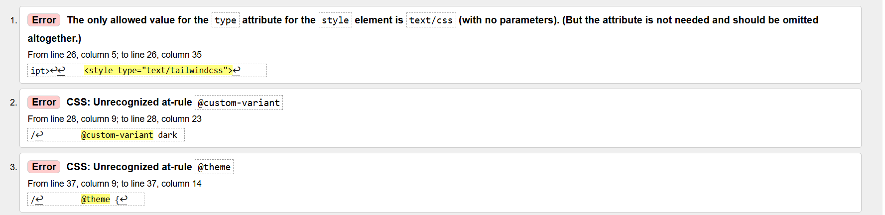
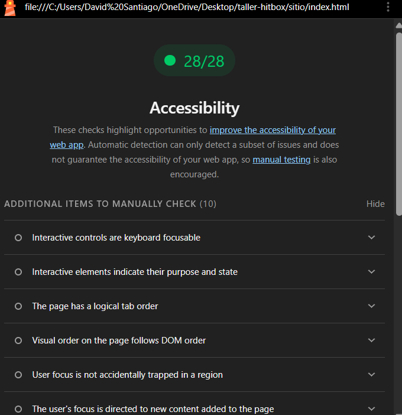

# HITBOX · Academia de Boxeo

Landing page de **HITBOX**, una academia de boxeo ficticia ubicada en Neiva (Huila), desarrollada como trabajo individual de la asignatura **Seminario** del programa de Ingeniería de Software de la Fundación Escuela Tecnológica de Neiva Jesús Oviedo Pérez (FET).

- **Sitio publicado:** [PEGAR ENLACE DE GITHUB PAGES]
- **Video explicativo:** https://www.youtube.com/watch?v=T6DfHha9lFA
- **Autor:** David Santiago Sierra Galindo
- **Docente:** Camilo Morales Vargas

## Descripción

| | |
|---|---|
| **Temática** | Academia de boxeo y preparación física |
| **Público objetivo** | Jóvenes y adultos de 16 a 35 años de Neiva que quieren empezar a entrenar boxeo o mejorar su condición física, sin experiencia previa. |
| **Propósito** | Dar a conocer la academia, mostrar los entrenamientos y horarios, resolver dudas frecuentes y recibir solicitudes de información por medio de un formulario. |

### Tecnologías

- HTML5
- Tailwind CSS 4 (Play CDN `@tailwindcss/browser@4`)
- JavaScript puro (sin librerías)
- Google Fonts: **Oswald** (títulos) e **Inter** (textos).

### Paleta de colores (regla 60-30-10)

Definida con la directiva `@theme` dentro de `<style type="text/tailwindcss">`.

| Rol | Token | Modo claro | Modo oscuro |
|---|---|---|---|
| 60 % Dominante (fondo) | `fondo` / `fondo-oscuro` | `#F5F5F4` | `#0B0B0C` |
| 30 % Secundario (superficies, tarjetas, navbar) | `superficie` / `superficie-oscura` | `#FFFFFF` | `#18181B` |
| 10 % Acento (botones, etiquetas, títulos de tarjetas) | `acento` / `acento-suave` | `#B91C1C` | `#F87171` |
| Éxito (toast) | `exito` | `#15803D` | `#15803D` |
| Error (validación) | `error` / `error-suave` | `#BE123C` | `#FDA4AF` |
| Advertencia (avisos) | `aviso` / `aviso-suave` | `#B45309` | `#FBBF24` |

El contraste se verificó con WebAIM Contrast Checker; todas las combinaciones de texto superan 4.5:1 (por ejemplo, blanco sobre `#B91C1C` = 6.5:1 y `#F87171` sobre `#0B0B0C` = 7.0:1).

### Funcionalidades

- Navbar fija con menú en celular (se cierra al elegir un enlace o con la tecla Escape).
- Modo claro y oscuro con la variante `dark:` de Tailwind; la preferencia se guarda en `localStorage`.
- Diseño responsive mobile-first con los prefijos `sm:`, `md:` y `lg:` (tarjetas en 1, 2 y 3 columnas).
- Acordeón de preguntas frecuentes con JavaScript (componente extra).
- Formulario con validación en JavaScript: campos obligatorios, correo válido, mensajes de error debajo de cada campo y toast verde de confirmación que desaparece a los 4 segundos.
- Accesibilidad: textos alternativos, etiquetas `label`, `aria-expanded`, `aria-invalid`, `aria-live`, enlace "Saltar al contenido" y foco visible.

## Cómo ejecutarlo

1. Descarga o clona el repositorio.
2. Abre el archivo `index.html` en el navegador.
3. No necesita instalación porque utiliza el Play CDN de Tailwind.

---

## Prompt maestro

> **Rol:** Actúa como desarrollador frontend senior especializado en Tailwind CSS 4, diseño responsive y accesibilidad web (WCAG 2.2).
>
> **Contexto:** Voy a crear la landing page de "HITBOX", una academia de boxeo de Neiva (Huila) dirigida a jóvenes y adultos de 16 a 35 años que quieren empezar a entrenar sin experiencia previa. El objetivo del sitio es presentar la academia, mostrar los tipos de entrenamiento y los horarios, responder dudas comunes y recibir solicitudes de información. El estilo debe transmitir disciplina y energía: fondos oscuros, acento rojo y tipografía fuerte en mayúsculas.
>
> **Tareas:** Construye una página con estas secciones, en este orden:
>
> 1. Navbar fija con el logo "HITBOX." en texto, enlaces a Inicio, Nosotros, Entrenamientos, Horarios y Contacto, y un botón para cambiar de tema. En celular debe convertirse en menú hamburguesa que se abre y se cierra con JavaScript.
> 2. Hero con el lema "DISCIPLINA · FUERZA · RESPETO", el título "SUPERA TUS LÍMITES", un subtítulo, imagen de fondo de boxeo con capa oscura y un botón "COMIENZA A ENTRENAR".
> 3. Sección "Nosotros" con texto e imagen en dos columnas (una columna en celular).
> 4. Sección "Entrenamientos" con tres tarjetas (Boxeo, Preparación física, Técnica y estrategia), cada una con imagen, título, descripción corta y efecto hover.
> 5. Tabla de horarios de referencia.
> 6. Preguntas frecuentes.
> 7. Formulario de contacto con nombre, correo, entrenamiento de interés (lista desplegable) y mensaje, validado con JavaScript.
> 8. Pie de página con el logo, el lema, enlaces y derechos reservados.
>
> Agrega un botón para cambiar entre modo claro y modo oscuro.
>
>Usa solo HTML, Tailwind CSS 4 mediante el Play CDN (https://cdn.jsdelivr.net/npm/@tailwindcss/browser@4) y JavaScript puro, sin otras librerías. Define los colores con `@theme`: fondo casi negro, gris oscuro para las superficies y rojo como acento, más verde para éxito, rojo para error y ámbar para advertencia. Diseña mobile-first. Cumple con accesibilidad: textos alternativos en las imágenes, etiquetas en los campos, contraste mínimo de 4.5:1 y foco visible.
>
> **Formato de salida:** Entrega un único archivo `index.html` con el JavaScript al final del `body`, el código indentado y comentarios en español que separen cada sección. Usa imágenes de ejemplo de Unsplash. Al final, explica en una lista corta cómo abrir el archivo y qué partes debería personalizar.

---

## Bitácora de prompts

**Versión 1:** Resultado del prompt maestro. Tenía todas las secciones y el menú hamburguesa funcionaba, pero al revisarla contra los requisitos del taller encontré los problemas que se corrigieron en estas iteraciones.

| # | Prompt de ajuste enviado | Problema que buscaba resolver | Resultado obtenido | ¿Funcionó? |
|---|---|---|---|---|
| 1 | "El formulario muestra un solo mensaje abajo y se detiene en el primer error. Haz que valide todos los campos a la vez y muestre el error en rojo debajo de cada campo, marcando el borde del campo con error." | Los errores no aparecían junto a cada campo, que es lo que pide el requisito. | Cada campo tiene un `
` conectado con `aria-describedby`; el borde cambia con la variante `aria-invalid:`, el foco va al primer campo con error y el mensaje se actualiza mientras se escribe. | Sí |
| 2 | "Cuando el formulario se envía bien, solo cambia un texto. Agrega un toast verde de confirmación abajo a la derecha que desaparezca a los 4 segundos." | No existía el toast de confirmación. | Se creó un `div` fijo con `role="status"` que aparece con transición de opacidad y desplazamiento y se oculta con `setTimeout` a los 4 segundos. | Sí |
| 3 | "El modo oscuro está hecho con una clase .claro y CSS propio. Cámbialo para usar la variante dark: de Tailwind 4 y que en modo claro también cambien los campos del formulario y la tabla. Guarda la preferencia al recargar." | El modo oscuro no usaba la variante `dark:` y en modo claro los inputs y la tabla seguían oscuros. | Se agregó `@custom-variant dark (&:where(.dark, .dark *));`, se borró el CSS propio, todos los elementos tienen su par `dark:` y el tema se guarda en `localStorage`. | Sí |
| 4 | "Los colores de @theme están definidos pero el HTML usa red-500 y neutral-900. Reorganiza la paleta con la regla 60-30-10 (fondo, superficie y acento) y úsala en todo el sitio. El color de error no puede ser el mismo rojo de la marca. Agrega Oswald para títulos e Inter para textos." | El `@theme` no se usaba, no se veía la regla 60-30-10 y no había fuentes de Google. | Nuevos tokens `fondo`, `superficie`, `acento`, `exito`, `error` y `aviso`, más `--font-titulo` y `--font-texto`. Ahora las clases son `bg-fondo`, `text-acento`, `font-titulo`, etc. | Sí |
| 5 | "En modo claro el texto red-500 sobre blanco no llega a 4.5:1. Corrige el contraste de todos los textos en los dos modos." | Contraste insuficiente (unos 3.7:1) que Lighthouse marcaba. | El acento en modo claro pasó a `#B91C1C` (6.5:1 sobre blanco) y en oscuro a `#F87171` (7.0:1). El análisis de accesibilidad quedó sin errores en ambos modos. | Sí |
| 6 | "Solo uso el prefijo md:. Haz que las tarjetas sean de 1 columna en celular, 2 en tablet y 3 en computador, y usa también sm: y lg: en los tamaños de texto y espaciados." | El requisito pide al menos tres prefijos (`sm`, `md`, `lg`). | Grid `grid-cols-1 sm:grid-cols-2 lg:grid-cols-3` y títulos `text-5xl sm:text-6xl lg:text-7xl`. | Sí |
| 7 | "Cambia las preguntas frecuentes de details a un acordeón con JavaScript con 4 preguntas, que deje solo una abierta y use aria-expanded." | Convertir las preguntas en un componente extra hecho con JavaScript y accesible. | Botones con `aria-expanded` y `aria-controls`; al abrir una se cierran las demás y el ícono `+` rota 45° hasta formar una `×`. | Sí |
| 8 | "Cuando hago clic en un enlace del menú, el navbar fijo tapa el título de la sección." | El navbar fijo tapaba el inicio de cada sección. | Se agregó `scroll-pt-24` en `<html>`. | Sí |

## Cambios manuales (sin IA)

#	Cambio	Archivo / líneas
1	Ajuste de algunos textos y descripciones para adaptarlos a la temática de la academia HITBOX.	
2	Organización de las imágenes utilizadas en las diferentes secciones de la página.	
3	Revisión del contenido y corrección de algunos detalles visuales de la página.	
## Pruebas realizadas

- Vista responsive en celular (390 px), tablet (768 px) y computador (1366 px) con las herramientas de desarrollador (F12).
- Validación del HTML en validator.w3.org: [3 errores, algunos causados por Tailwind CSS / ].
- Lighthouse, accesibilidad: 100 / 100 ().
- Prueba del menú, del modo oscuro, del acordeón, del formulario y del toast.

## Créditos

- Imágenes de [Unsplash](https://unsplash.com), bajo la licencia de Unsplash.
- Fuentes de [Google Fonts](https://fonts.google.com).